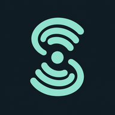
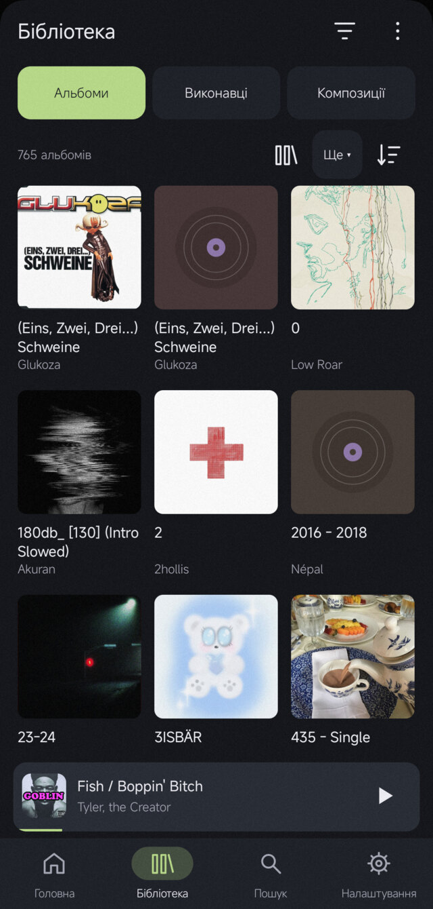
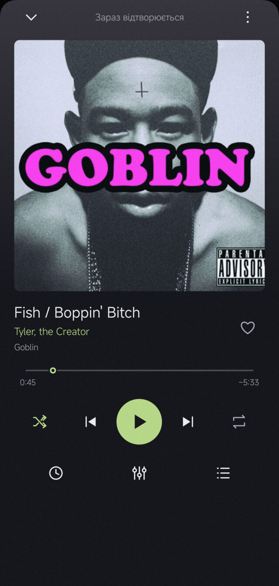
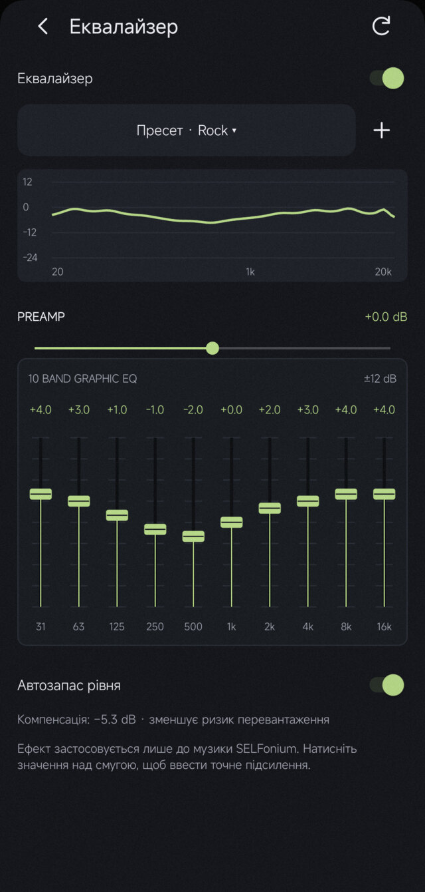
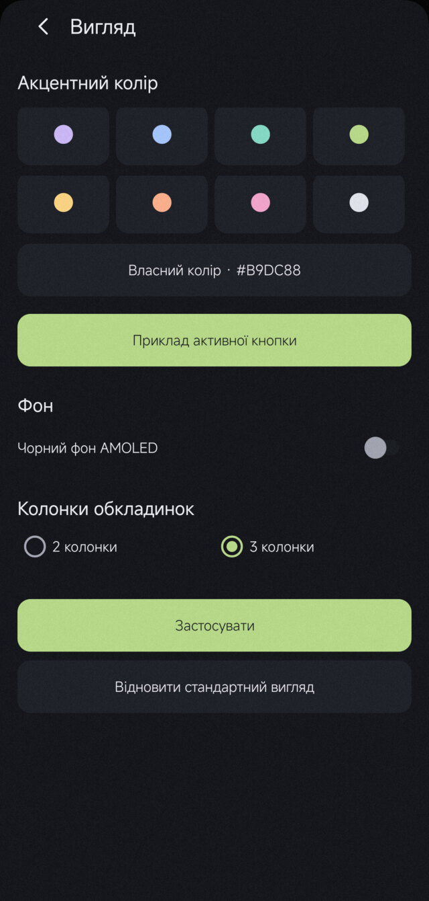

<h1 align="center"> SELFonium</h1>

SELFonium is an open-source Android music player for Subsonic/OpenSubsonic servers and local audio. All implemented features are available without subscriptions or paid unlocks.

Development and device testing focus on **Navidrome**. Other compatible Subsonic servers are supported on a best-effort basis, without a guarantee of full compatibility. The interface supports English, Ukrainian, Polish, German, French and Spanish, with a language selector in settings.

## Features

- Browse albums, artists and tracks; search your library and keep local playlists, favorites and listening history.
- Sync Subsonic track favorites and server playlists. Offline favorite changes are saved and retried when connectivity returns.
- Play local files, download tracks for offline listening and open direct radio streams.
- View storage usage, manage downloads and cache limits, and check or clean up offline copies.
- Manage the playback queue, shuffle, repeat, playback speed and sleep timer.
- Adjust a ten-band graphic equalizer with preamp, built-in presets and saved custom settings.
- Customize the accent color, AMOLED background and album-grid density.
- Check stable GitHub Releases in settings, download verified updates and open Android’s installer.

Server playlist editing requires a connection. OpenSubsonic extension discovery is implemented; synchronized lyrics and API-key authentication are not implemented. See [features and limitations](docs/FEATURES.md).

## Screenshots

| Library | Player | Equalizer | Appearance |
|---|---|---|---|
|  |  |  |  |

Screenshots show version 0.5.1. Later versions refine the layout and source setup.

## Install

Download the APK from [GitHub Releases](https://github.com/TripShuti/SELFonium/releases/latest), open it on your phone and allow installation from that source if Android asks. New releases provide an APK named `SELFonium-v<version>.apk`. Older releases may omit the `v` in the asset filename.

Requirements: **Android 8.0 or later (API 26)**. Remote playback needs a compatible server account and network access; downloaded and local files can play offline. Grant audio-library and notification permissions when needed.

Version 0.6.4 and later include an [in-app updater](docs/UPDATES.md) under Settings → Updates. Install updates over the existing app to retain data. Official updates must use the same signing identity. Local and CI debug builds can have a different signature and are intended for development.

To connect a server, open settings using the gear icon, find the music sources section and add a Subsonic server with its base URL, username and password. Do not append `/rest` to the URL. Sync the source, then select a track from the library.

## Build from source

Install JDK 17 or 21, Python 3.11+, Android SDK Platform 35 and Build Tools 35.0.0. On Linux:

```sh
git clone https://github.com/TripShuti/SELFonium.git
cd SELFonium
bash scripts/build.sh
```

The debug APK is written to `app/build/outputs/apk/debug/app-debug.apk`. See [building](docs/BUILDING.md) for SDK setup, release outputs and signing requirements.

## Development

Version 0.6.6 adds simplified library navigation and server listening reports with offline scrobble delivery. These changes are absent from 0.6.5 and earlier; see the [changelog](CHANGELOG.md#066) and [feature status](docs/FEATURES.md).

[Contributing](CONTRIBUTING.md) · [Testing](docs/TESTING.md) · [Roadmap](docs/ROADMAP.md) · [Changelog](CHANGELOG.md)

Technical details: [server synchronization](docs/SYNCHRONIZATION.md), [equalizer](docs/EQUALIZER.md), [dependencies](docs/DEPENDENCIES.md).

Report reproducible problems through [GitHub Issues](https://github.com/TripShuti/SELFonium/issues). Include the app, Android and server versions and steps to reproduce. Remove credentials and personal data from attachments.

## License

SELFonium is licensed under the [MIT License](LICENSE). Dependencies retain their own licenses; see [dependency information](docs/DEPENDENCIES.md).
